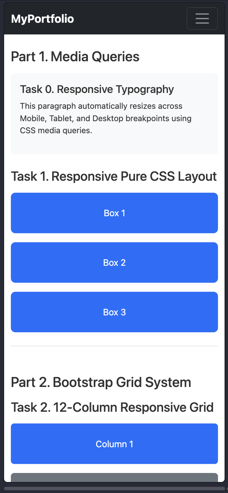
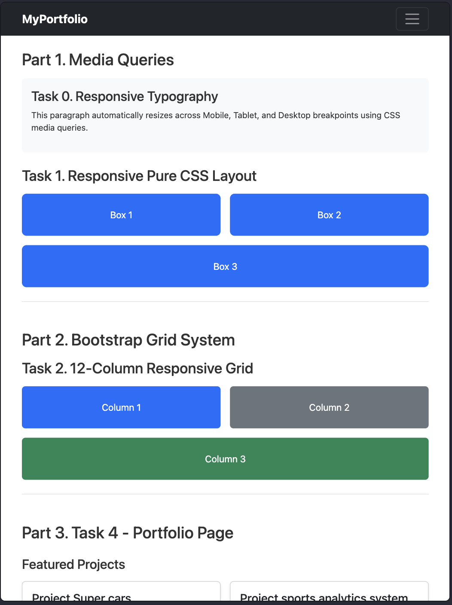
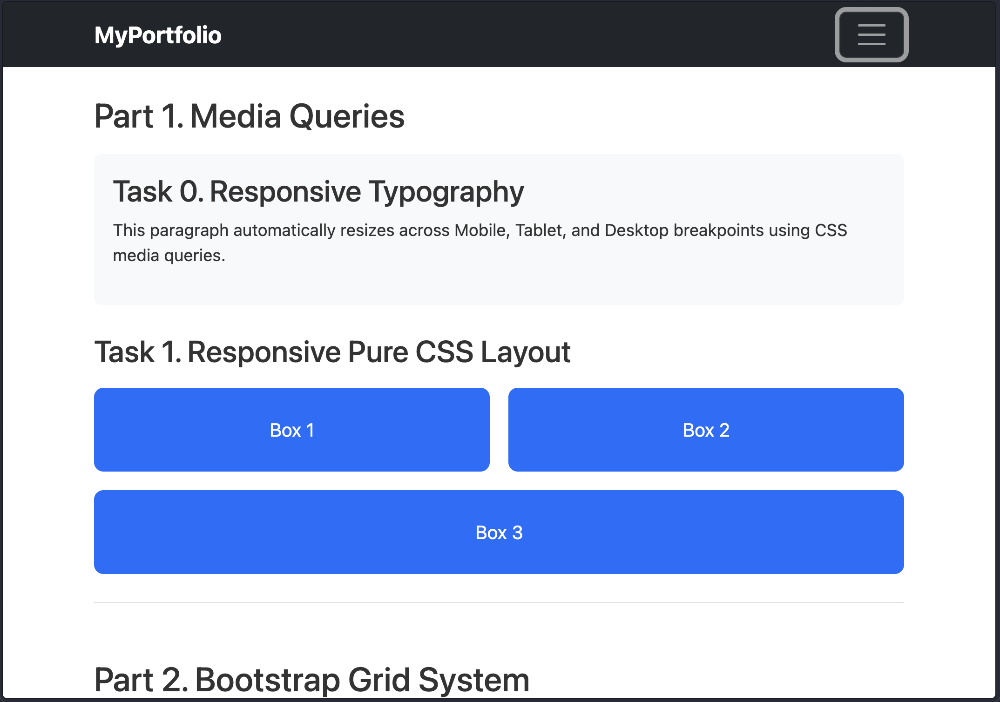

# Assignment 3: Responsive Web Design

**Student:** Kaisar Ashimbay  
**Group:** SE-2540  
**University:** Astana IT University  

---

## About The Project
This project is for my Front-End course. I built a web page that adjusts automatically for mobile phones, tablets, and desktops using pure CSS and Bootstrap.

---

## Tasks Done

* **Part 1: Pure CSS Media Queries**
  * **Task 0:** Dynamic typography — fonts change size depending on screen width.
  * **Task 1:** 3 boxes layout without Bootstrap. Mobile: 1 column, Tablet: 2 top + 1 bottom, Desktop: 3 side-by-side.

* **Part 2: Bootstrap Grid & Navbar**
  * **Task 2:** 12-column grid (`col-12 col-md-6 col-lg-4`).
  * **Task 3:** Responsive navbar with a hamburger menu on small screens.

* **Part 3: Portfolio Page (Task 4)**
  * Combined Navbar, project cards, sidebar with my info, and footer.

---

## Work Process
1. Connected Bootstrap 5.3 CDN.
2. Created layout for Part 1 and wrote CSS media queries.
3. Added Bootstrap grid and tested column wrapping.
4. Built the portfolio page with my real projects.
5. Checked everything on mobile and desktop in Chrome.

---

## Screenshots
* Mobile view

* Tablet view

* Desktop view

